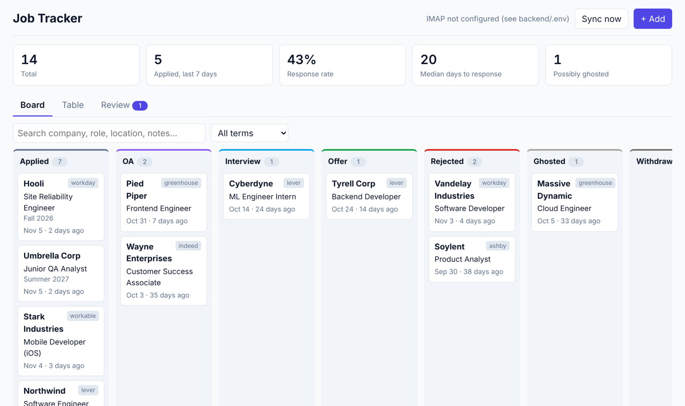
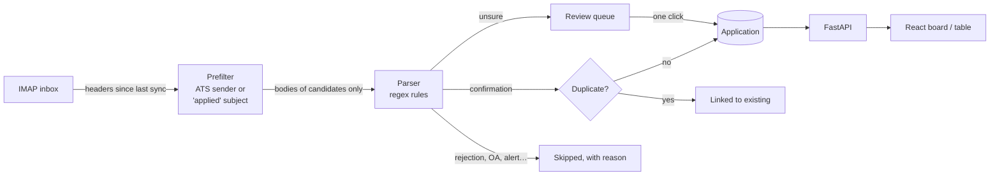

# Job Tracker

A personal job-application tracker that fills itself in. It reads your inbox, finds the
"thanks for applying" email every application sends, and adds the job to a kanban board. You
never type in an application after applying; you only move cards when something happens
(OA, interview, offer, rejection).



## Features

- **Applications from email.** Confirmations from Greenhouse, Lever, Workday, Ashby, LinkedIn,
  Indeed, Workable and about 15 other applicant tracking systems become applications with company,
  role and date. It works no matter which computer you applied from, since it only reads email.
- **Review queue.** Emails that look like confirmations but where the company can't be found
  wait for a one-click accept, and a "Skipped emails" list (with the reason) lets you rescue
  anything the parser got wrong.
- **Board and table.** Drag a card to change its status, or use the status dropdown in the table.
  Search and filter by term in both views. Location, term, next action and follow-up date are
  editable on every application, and a due follow-up is highlighted.
- **Stats.** Response rate, median days to a response, applications in the last 7 days, and
  "possibly ghosted" (still Applied after 30 days).
- **Automatic syncing** every N minutes while the server runs, with the last failure shown in
  the header.
- **CSV import** from an existing spreadsheet tracker.
- **Private.** No LLM and no third-party service: rules run locally, and the data is a SQLite file.

## Quick start

Needs Python 3.11+ and Node 22+.

```bash
git clone https://github.com/ryanjguo/job-tracker && cd job-tracker

# backend
cd backend
python -m venv .venv && source .venv/bin/activate
pip install -r requirements.txt
cp .env.example .env              # then fill it in, see below
python -m app.cli test-imap       # checks the login
python -m app.cli sync            # first sync looks back 90 days

# frontend (build once; FastAPI serves it)
cd ../frontend && npm install && npm run build

# run everything on http://localhost:8000
cd ../backend && uvicorn app.main:app
```

Just want to look around? Skip `.env` and run `python -m app.cli seed-demo` for fake data.

### Gmail App Password

The tracker logs in over IMAP with an App Password, which doesn't expire like OAuth tokens do
for personal Google Cloud apps.

1. Turn on [2-Step Verification](https://myaccount.google.com/signinoptions/two-step-verification)
   for your Google account (App Passwords require it).
2. Create an App Password at <https://myaccount.google.com/apppasswords>.
3. Put your address in `IMAP_USER` and the 16-character password in `IMAP_PASSWORD` in
   `backend/.env`.

It only reads mail, and it uses `BODY.PEEK`, so nothing gets marked as read. Other providers
(Outlook, Fastmail, iCloud) work too: set `IMAP_HOST` and use that provider's app password.

### Configuration (`backend/.env`)

| Setting | Default | What it does |
|---|---|---|
| `IMAP_USER`, `IMAP_PASSWORD` | | Login. Leave empty to run without syncing. |
| `IMAP_HOST`, `IMAP_PORT` | `imap.gmail.com`, `993` | |
| `IMAP_FOLDER` | `INBOX` | Use `[Gmail]/All Mail` if filters skip the inbox. |
| `SYNC_EVERY_MINUTES` | `0` (off) | Sync in the background while the server runs, e.g. `180`. |
| `INITIAL_LOOKBACK_DAYS` | `90` | How far back the very first sync reads. |
| `GHOST_AFTER_DAYS` | `30` | When an Applied card is flagged "possibly ghosted". |
| `DUPLICATE_WINDOW_DAYS` | `60` | Two confirmations for the same company and role within this window count as one. |
| `DATABASE_URL` | `sqlite:///./tracker.db` | Any SQLAlchemy URL (e.g. a hosted Postgres). |
| `ALLOWED_HOSTS` | `localhost,127.0.0.1,::1` | Host names the server answers to. Add your domain if you host it. |

## Keeping it in sync

Pick one:

- **While the server runs:** set `SYNC_EVERY_MINUTES=180`. The first sync runs 15 seconds after
  startup.
- **Without the server running (cron):** run `crontab -e` and add

  ```
  0 */3 * * * cd /path/to/job-tracker/backend && .venv/bin/python -m app.cli sync >> sync.log 2>&1
  ```

- **By hand:** the "Sync now" button.

Syncs are safe to repeat: every email is recorded by its Message-ID, so nothing is added twice.

## Upgrading

```bash
git pull
cd backend && pip install -r requirements.txt
cd ../frontend && npm install && npm run build
```

The database upgrades itself on startup. Parser fixes only apply to new mail, so after
updating, run the current rules over emails an older version skipped:

```bash
cd backend
python -m app.cli recheck --dry-run   # lists what would change
python -m app.cli recheck             # applies it (last 90 days; --days to change)
```

Emails you dismissed are left alone.

## Importing an existing spreadsheet

Export the sheet as CSV, then preview and import:

```bash
python -m app.cli import-csv applications.csv --dry-run   # shows what would be added
python -m app.cli import-csv applications.csv
```

It finds the header row even below a title or totals block, maps the usual columns (Company,
Role / Position, Location, Date Applied, Term, Status, Next Action, Follow-up, Job Link, Notes)
and keeps any other column as a note line.

## Development

```bash
cd backend && python -m pytest -q      # backend tests
uvicorn app.main:app --reload           # API on :8000
cd frontend && npm run dev              # UI on :5173 with hot reload, proxies /api to :8000
npm run lint
```

Work happens in small issues, one branch and squash-merged PR each, with conventional commit
titles. See `CLAUDE.md` for the conventions and `PLAN.md` for the issue list and backlog.

## How it works



- **Backend:** FastAPI, SQLAlchemy 2, SQLite, stdlib `imaplib`. `backend/app/parser.py` holds
  all the rules; `sync.py` runs the pipeline; `scheduler.py` runs it on a timer.
- **Frontend:** React + TypeScript + Vite, plain CSS, built into `frontend/dist` and served by
  FastAPI so one process runs everything.

### Design decisions

- **Email only creates applications; you set statuses.** Rejection, OA, interview and offer
  emails are recognised and deliberately skipped. Moving a card takes a second, and a wrong
  automatic status would quietly hide an application.
- **Rules before an LLM.** Confirmation emails come from a few dozen applicant tracking systems
  with predictable wording, so regex gets most of them, costs nothing and keeps email on your
  machine. Anything uncertain goes to the review queue instead of being guessed.
- **Confirmations describe next steps.** "If we decide not to move forward…" or "candidates may
  receive a HackerRank assessment" aren't rejections or OA invites, so ignore rules skip
  conditional sentences and, when the subject is a confirmation, only look at the subject for
  OA / interview wording.
- **Nothing is lost silently.** Every email the parser looks at is stored with its outcome and
  reason, deleted applications don't come back on the next sync, and a failed background sync
  shows up in the header.
- **Local, but not open to other websites.** There's no login, so the API only answers to known
  host names and refuses writes that lack the dashboard's `X-Job-Tracker` header, which other
  websites can't send. Hosting it on the internet would still need real authentication.
- **No extension, nothing on other machines.** You can apply from any computer (including a
  managed work laptop); the inbox is the only input.

## Roadmap

Ideas in `PLAN.md`: suggested status changes from rejection / OA / interview emails (#31), an LLM
fallback for the review queue, finding posting URLs through Greenhouse / Lever job-board APIs,
a morning digest, and a hosted database so the dashboard works from any device.
